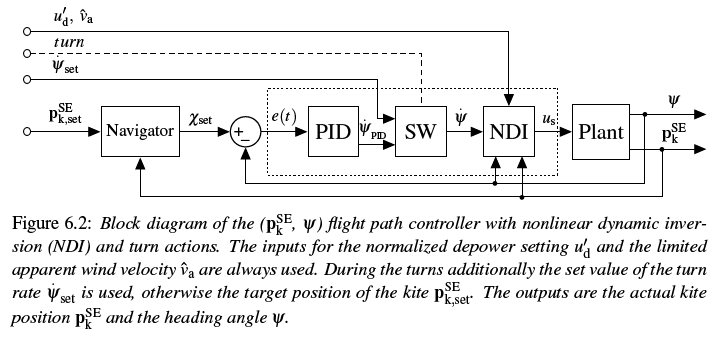
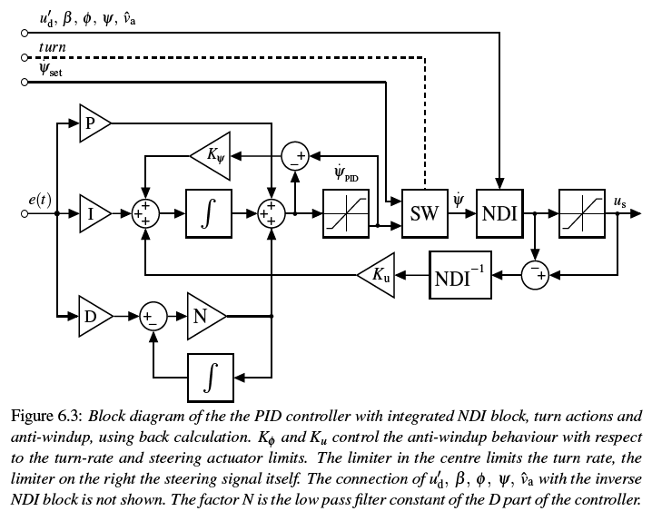

# Flight path controller

The [`FlightPathController`](@ref) is implemented as specified in chapter six of the
[PhD thesis](https://research.tudelft.nl/en/publications/a-methodology-for-the-design-of-kite-power-control-systems)
of Uwe Fechner.

```julia
FlightPathController
FPCSettings
on_control_command(fpc; attractor=nothing, psi_dot_set=nothing, radius=nothing, intermediate = true)
on_est_sysstate(fpc, phi, beta, psi, chi, omega, v_a; u_d=nothing, u_d_prime=nothing)
on_timer(fpc)
calc_steering(fpc, parking)
```

The control commands are usually received from the [`FlightPathPlanner`](@ref), the output
of the model or the system state estimator must call [`on_est_sysstate`](@ref) each time step.




