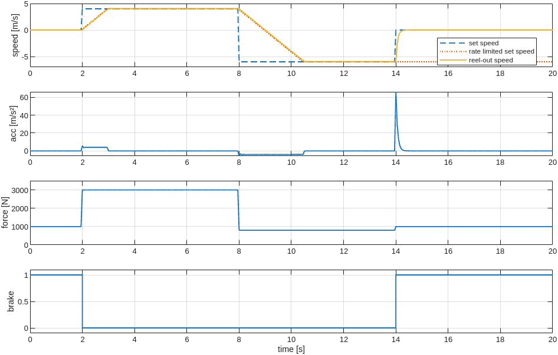
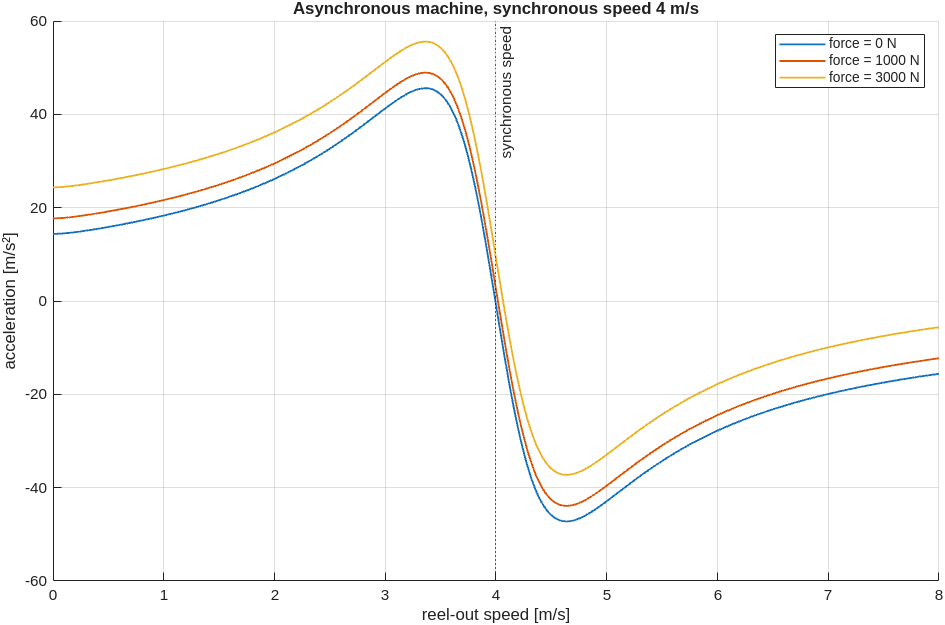

# Winch Model in Matlab

The model of the winch can be implemented in Matlab instead of Julia. The rest of the simulation
stays in Julia: the kite and tether model (KiteModels.jl), the winch controller
(WinchControllers.jl), the flight path controller and the state machine `SystemStateControl`.
The Matlab winch is driven by `SystemStateControl` through the Julia winch controller for the full
power cycle: parking, power production, reel-in and depower.

The Matlab function
[`examples/matlab/async_machine_step.m`](https://github.com/OpenSourceAWE/KiteControllers.jl/blob/main/examples/matlab/async_machine_step.m)
implements the same model as the `AsyncMachine` of
[WinchModels.jl](https://github.com/aenarete/WinchModels.jl): an asynchronous machine with gearbox,
drum, friction and brake. It is a starting point for your own Matlab winch models.

## Requirements

- Matlab R2020b or newer, with a license that allows starting the Matlab engine. Matlab Coder is
  not needed. Octave is not supported.
- On Linux, `csh` (the Matlab engine is started with it).
- WinchModels.jl 0.3.13 and KiteModels.jl 0.13.2 or newer, which support the `MatlabMachine`;
  `Pkg.instantiate()` installs them (see Setup).

## Setup

The Matlab examples have their own environment, `examples/matlab`, because
[MATLAB.jl](https://github.com/JuliaInterop/MATLAB.jl) cannot be installed without Matlab. In a
Julia session started in the root folder of KiteControllers.jl:

```julia
using Pkg
Pkg.activate("examples/matlab")
ENV["MATLAB_ROOT"] = "/usr/local/MATLAB/R2021a"   # only if the wrong Matlab is found
Pkg.instantiate()
Pkg.build("MATLAB")
```

Packages in the system image cannot be replaced by other versions. To work on development versions
of WinchModels.jl or KiteModels.jl, start Julia without the system image with
`bin/run_julia --nosysimage`.

## Usage

### Autopilot with the Matlab winch

Choose `autopilot_matlab` in the menu of the examples (`menu()`), or run:

```julia
include("examples/autopilot_matlab.jl")
```

This runs
[autopilot.jl](https://github.com/OpenSourceAWE/KiteControllers.jl/blob/main/examples/autopilot.jl)
with the Matlab winch model instead of the winch model of the selected project. If the active
environment is not `examples/matlab`, for example when started from the menu, the script starts a
new Julia process for it, without system image, and waits until the window is closed.

### Selecting the Matlab winch in the settings

In your own scripts, set the winch model in the settings file of the project:

```yaml
    winch_model: "MatlabMachine" # or AsyncMachine or TorqueControlledMachine
```

and load MATLAB.jl and add the folder of the Matlab function to the Matlab path before the first
time step. Start the Matlab engine before `Pkg` or `Downloads` are loaded, which KiteUtils.jl and
the packages that use it do: with Matlab R2025a, starting the engine later crashes Julia
(segmentation fault), probably because Julia and Matlab use different versions of libcurl.
`mat"..."` starts the engine:

```julia
using MATLAB
mat"addpath('examples/matlab')"
using KiteModels
```

`KPS3` and `KPS4` then create a `MatlabMachine`. An unknown value of `winch_model` stops with an
error.

## How it works

The acceleration of the winch is calculated in the residual of the DAE solver, which evaluates it
many times per time step. A call of Matlab costs about a millisecond, so Matlab is called only once
per time step, in `update_winch_state!` of WinchModels.jl:

- Julia passes the reel-out speed and the tether force at the start of the time step, the set speed
  of the winch controller and the state of the brake and of the rate limiter of the set speed.
- `async_machine_step.m` updates the brake and the rate limited set speed and returns the
  acceleration and its partial derivatives with respect to speed and force.
- Within the time step, the residual uses the first order expansion
  `acc0 + dacc_dv*(speed - speed0) + dacc_dF*(force - force0)`, evaluated in Julia.

### Linearization within the time step

Within one time step, the set speed, the state of the brake and the parameters are constant, so
the acceleration of the winch is a function of the reel-out speed `v` and the tether force `F`
only:

```text
acc = f(v, F)
```

At the start of each time step, Matlab evaluates this function once at the current point
`(v0, F0)` and returns its value and its two slopes:

```text
acc0    = f(v0, F0)
dacc_dv = ∂f/∂v (v0, F0)
dacc_dF = ∂f/∂F (v0, F0)
```

During the time step, the DAE solver needs the acceleration many times, at slightly different
values of `v` and `F`. Instead of calling Matlab, it uses the tangent plane through this point,
the first two terms of the Taylor series (first order expansion):

```text
acc ≈ acc0 + dacc_dv * (v - v0) + dacc_dF * (F - F0)
```

The error of this approximation depends on how curved `f` is:

- In the force there is no error: the force enters the torque balance linearly, so `dacc_dF` is
  constant.
- In the speed there is an error: the motor torque depends on the slip `δ = ω_sync - ω` as
  `δ / (R² + L²δ²)`, and the Coulomb friction is a smooth sign function of the speed. The error grows
  approximately with `½ ∂²f/∂v² (v - v0)²`, quadratically with the change of the speed within the
  time step and with the curvature of the torque-slip curve.
- With the brake engaged there is no error: the acceleration is `brake_acc * v`, which is linear.

The error is therefore largest when the speed changes a lot within one time step in a strongly
curved part of the torque-slip curve, for example at the transitions between reel-out and reel-in.
Over full power cycles the effect is small, see [Accuracy](@ref). If more accuracy were needed,
Matlab could also return the second derivative `∂²f/∂v²`, and Julia would add the quadratic term;
this still needs only one call of Matlab per time step.

### Calling Matlab

The parameters (gear ratio, drum radius, inertia, friction, maximal acceleration, motor data) are
sent to Matlab once, before the first time step. The Matlab engine is called by the package
extension `WinchModelsMATLABExt`, which is loaded by `using MATLAB`: one evaluation per time step
with the inputs as text, without the exception check of MATLAB.jl, and one read of the result
vector. Errors in Matlab are reported as Julia errors.

## Accuracy

[`examples/matlab/compare_full_cycle.jl`](https://github.com/OpenSourceAWE/KiteControllers.jl/blob/main/examples/matlab/compare_full_cycle.jl)
flies the power cycles of autopilot.jl, without viewer and turbulence, with the Julia
`AsyncMachine` and with the `MatlabMachine`, for 460 s:

| project | energy, Julia | energy, Matlab | difference |
| --- | --- | --- | --- |
| hydra10_951 | 654.2 Wh | 654.3 Wh | 0.014 % |
| hydra20_426 | 752.3 Wh | 752.4 Wh | 0.018 % |
| hydra20_600 | 1759.4 Wh | 1760.2 Wh | 0.044 % |
| hydra20_920 | 1555.1 Wh | 1557.8 Wh | 0.177 % |

Mean and maximal tether force differ by at most 0.13 %. The difference comes from the
linearization within the time step.
[`examples/matlab/test_async_machine_step.jl`](https://github.com/OpenSourceAWE/KiteControllers.jl/blob/main/examples/matlab/test_async_machine_step.jl)
checks that the Matlab function itself agrees with the Julia model to 1e-12.

## Speed

One time step with the Matlab winch takes about 1.5 ms (median) and 2.2 ms (99th percentile),
measured with Matlab R2021a on Linux, compared to less than 0.1 ms with the Julia winch model.
The simulation is real-time capable up to a time-lapse factor of about 18 (2.8 ms per time step of
50 ms); 24 is too fast. The 3D viewer of autopilot.jl needs additional time.

The speed of the Matlab engine depends on the computer and the Matlab version. On a laptop with
Matlab R2025a, one time step took about 4.3 ms (median) and 7 ms (99th percentile), and a call of
the engine was about 2.5 times slower than with R2021a on the first computer. There, the simulation
is real-time capable up to a time-lapse factor of about 6; with 12 it missed every deadline.
Choose the time-lapse factor in the menu of autopilot.jl accordingly.
[`examples/matlab/bench_engine.jl`](https://github.com/OpenSourceAWE/KiteControllers.jl/blob/main/examples/matlab/bench_engine.jl)
measures the cost of different ways of calling Matlab.

## Your own Matlab winch model

Replace the body of `async_machine_step.m` and keep its interface:

```matlab
async_machine_step(p)    % store the parameter struct p
y = async_machine_step(x)
% x = [speed, force, set_speed, use_brake, brake, last_set_speed]
% y = [acc0, dacc_dv, dacc_dF, brake, last_set_speed]
```

`set_speed` is `NaN` if there is no set speed. The model is called once per time step, so it may
keep its own state in persistent variables, but the brake and the rate limited set speed must be
returned, because KiteModels saves and restores them. The partial derivatives must describe the
acceleration within the time step well; the accuracy of the simulation depends on them.

### Testing the model in Matlab

[`examples/matlab/winch_example.m`](https://github.com/OpenSourceAWE/KiteControllers.jl/blob/main/examples/matlab/winch_example.m)
runs the winch model in Matlab alone, without Julia. Use it to try out changes of the model before
running it in the full simulation. In Matlab, in the folder `examples/matlab`:

```matlab
winch_example
```

The script sets the parameters as Julia loads them for `system.yaml` and simulates the winch for
20 s with a time step of 50 ms. The set speed follows a profile, and the tether force is
prescribed for each part:

| time | set speed | tether force | |
| --- | --- | --- | --- |
| 0 to 2 s | 0 | 1000 N | brake engaged |
| 2 to 8 s | 4 m/s | 3000 N | reel-out |
| 8 to 14 s | -6 m/s | 800 N | reel-in |
| 14 to 20 s | 0 | 1000 N | brake engaged again |

As in the Julia simulation, `async_machine_step` is called once per time step. The speed is
integrated with the linearized implicit Euler method, using the partial derivative `dacc_dv`:
`v(t+dt) = v(t) + dt * acc0 / (1 - dt * dacc_dv)`. An explicit Euler step would be unstable,
because the torque-slip curve of the machine is steep.



The reel-out speed follows the set speed with the maximal acceleration of 4 m/s², and differs from
it by at most 0.063 m/s while reeling out. At t = 14 s the brake stops the winch within about
0.3 s. While the brake is engaged, the rate limited set speed keeps its last value.

A second figure shows the acceleration as a function of the reel-out speed for a synchronous speed
of 4 m/s, the torque-slip curve of the asynchronous machine. Near the synchronous speed the curve is
steep and almost linear, further away it is strongly curved: there, the linearization within the
time step is least accurate.



## Limitations

- Only the asynchronous machine is available in Matlab, not the `TorqueControlledMachine`.
- Matlab holds the parameters of one `MatlabMachine` at a time; they are sent again when another
  `MatlabMachine` is used. Change the parameters of a `MatlabMachine` before its first time step.
- The Matlab engine adds about 1.5 ms per time step, see [Speed](@ref).
